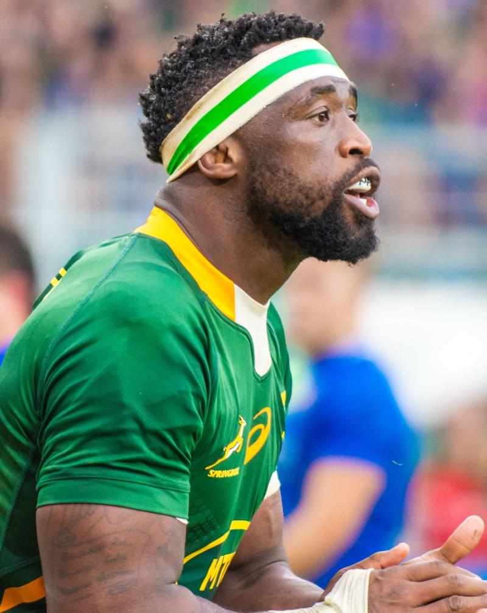

<figure>
  
  <figcaption>
    Siya Kolisi during Italy vs South Africa, 19 November 2022.
    Photo by ,
    ,
    via .
    Cropped and resized.
  </figcaption>
</figure>

Servant leadership isn't proclaimed from a stage. It's earned in the dirt.

Few people show this better than Siya Kolisi, the Springbok captain who led South Africa to back-to-back Rugby World Cup titles in 2019 and 2023.

## A Series That Made the Point

In August and September 2026, the Springboks and the All Blacks played a four-Test series billed as *Rugby's Greatest Rivalry*:

- **Test 1, Johannesburg:** Kolisi was left out as a precaution after a hamstring strain. The All Blacks won 33–16.
- **Test 2, Cape Town:** Kolisi returned as captain and scored a try. The Springboks won 33–26.
- **Test 3, Soweto:** The Springboks won 29–24, Kolisi's record 55th win as Springbok captain.
- **Test 4, Baltimore:** The Springboks won 43–28 to take the series 3–1. Kolisi made ten tackles in the first half alone.

Four matches don't prove cause and effect. The Springboks have one of the deepest squads in world rugby, and the wins in Cape Town and Soweto were tight. But the pattern is hard to ignore, and it raises a good question: what does a captain actually add?

## Doing the Donkey Work

In rugby, the "donkey work" is the grinding, unglamorous labour: hitting rucks, making low tackles, carrying into contact and clearing out at the breakdown. It rarely makes the highlight reel, but it creates the space for others to score.

That's where Kolisi earns his authority. As lock Eben Etzebeth put it: "The unseen work, his work ethic. He is an underrated player for what he does for us the team."

## Sharing the Lead

Kolisi doesn't pretend to have every answer, and he doesn't try to be the loudest voice in the room:

> I don't speak much. I am not the type of guy that will do those *Any Given Sunday* speeches before a match.

Instead, he delegates to the specialists around him:

> Luckily we have different leaders for different parts of the field – breakdown, lineouts and all that kind of stuff – if something is not working, I will look to the other leader to tell us what the solution is.

He's open about where that comes from. In his first Test as captain, against England in 2018, the Springboks fell behind early: "I had no idea what to do. So I had to look to Duane and all the other guys who were on the field at that time." His conclusion: "I preferred shared leadership."

## Letting Others Stand in the Limelight

When Rassie Erasmus made him captain, Kolisi recalls, "he said he didn't want my success from what we get as a team to be about me alone."

He has lived up to that. After the 2023 World Cup semi-final against England in Paris, he didn't talk about his own game. He talked about the replacements: "The reserves came on and made it clear they would win it for us. And they did."

## What I Take Into My Own Team

1. **Do the donkey work.** Unblocking people, reviewing pull requests, writing the ticket nobody wants to write, sitting in the tedious meeting so the team doesn't have to. It builds more trust than any all-hands speech.
2. **Lead through your specialists.** Like Kolisi's breakdown and lineout leaders, the person closest to the problem should make the call. My job is to know who that is and to back their decision.
3. **Give the credit away.** When the team delivers, the demo and the thanks belong to the people who built it.

Leadership isn't about standing in the spotlight. It's about doing the unseen work so your team can win.

## Sources

- , rugby.com.au, 20 August 2026
- , Daily Maverick, 29 August 2026
- , Sky Sports, 5 September 2026
- , eNCA, 13 September 2026
- , RugbyPass, 13 September 2026
- , SA Rugby magazine, 19 October 2023
- , SA Rugby magazine, 12 June 2020
- , SuperSport, 6 November 2025
